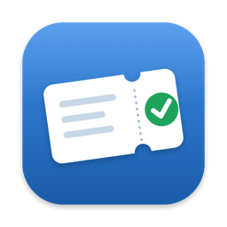
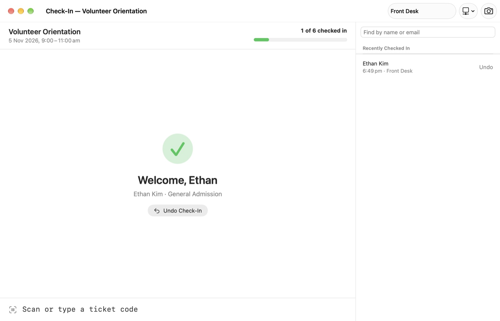
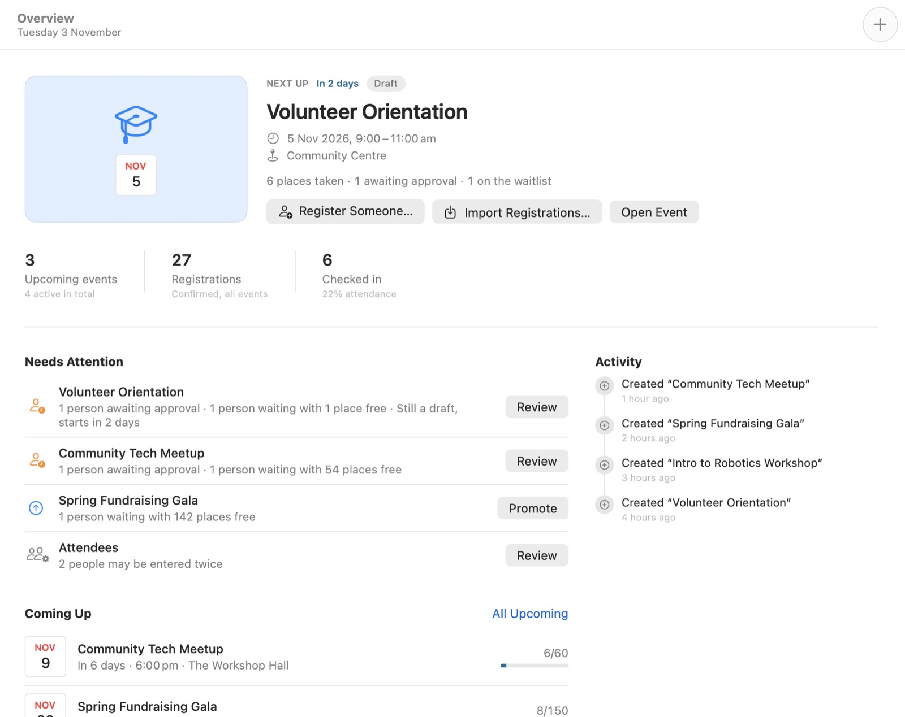

  

<h1 align="center">GatherKit for Mac</h1>

  Events, tickets and check-in for people who run events without an events team. 
  Register people, print tickets and badges, and check everyone in at the door, even with no internet.

  <a href="https://github.com/realbakari/gatherkit-mac/releases/latest/download/GatherKit.zip"><strong>Download for Mac</strong></a>
  ·
  <a href="https://bakarimustafa.com/gatherkit/">Website</a>
  ·
  <a href="https://github.com/realbakari/gatherkit-mac/releases">All releases</a>

## Install

1. Download [GatherKit.zip](https://github.com/realbakari/gatherkit-mac/releases/latest/download/GatherKit.zip).
2. Open the zip, then drag **GatherKit** to your Applications folder.
3. Open it from Applications.

GatherKit keeps itself up to date: it checks for a new version once a day and installs it the next time you quit. Choose **GatherKit › Check for Updates…** to check now. (Version 1.0.0 predates this, so if you have it, download the latest version once by hand.)

The app is signed with Bakari Mustafa’s Developer ID and notarised by Apple, so it opens without warnings. It needs **macOS 14** or later.

To look around before entering your own events, choose **Help › Explore the Sample Library**.

## What it does

- **Events and registrations:**
  - times in the event’s own time zone
  - approvals, waitlists, plus-ones, ticket types and capacity
  - one list of people across every event, with duplicates found and merged
- **Import:**
  - CSV exports from Eventbrite, Humanitix, Luma, Tito and Google Forms, or any spreadsheet
  - re-importing the same file updates registrations rather than duplicating them
  - direct sync with your own API key
- **Tickets and badges:** QR tickets, name badges on A4 and US Letter sheets or Brother QL and DYMO labels, and a paper guest list for the door.
- **Check-in:**
  - a check-in window that works offline, with a barcode scanner, the Mac’s camera, a typed code or a name search
  - a repeat scan never checks anyone in twice
  - check-ins from several Macs can be merged afterwards
- **Reports:** attendance, no-shows and arrivals by the quarter hour, as a PDF or as a CSV with no personal details.

## Privacy

No account, no server, no analytics and no advertising. Everything you enter stays on your Mac. The app only goes online when you sync with a ticketing platform you’ve connected, and once a day to check here for a new version (you can turn that off in Settings). The update check sends no personal data.

## Help

Press ⌘? in the app for the built-in guide. Otherwise email [bakari@bakarimustafa.com](mailto:bakari@bakarimustafa.com) or [open an issue](https://github.com/realbakari/gatherkit-mac/issues).

This repository holds the releases and `appcast.xml`, the update feed the app checks.

© 2026 Bakari Mustafa. All rights reserved.
